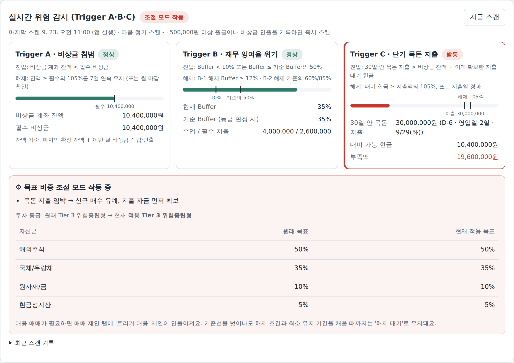
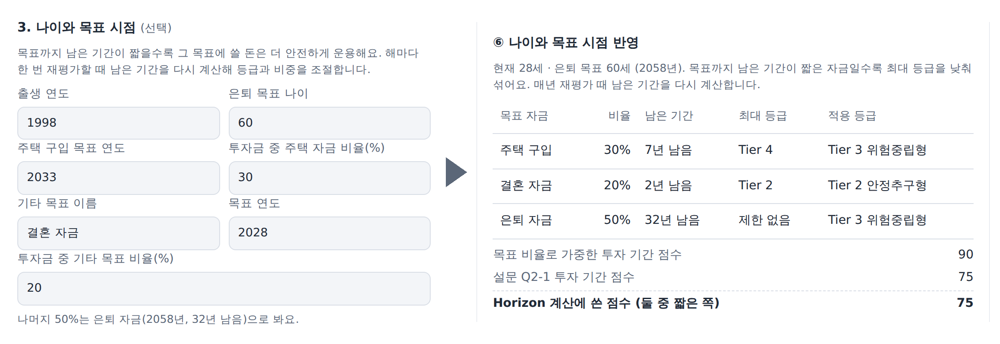
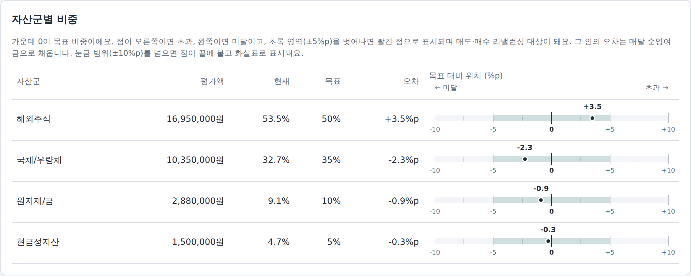

# 스마트플로우 — 가계부와 투자를 잇는 유동성 안전망

> 가계부의 수입·지출 흐름을 보고, 생활비가 흔들릴 것 같으면 투자 비중을 미리 조절해 주는 개인용 자산배분 웹 서비스입니다. (시연 단계)

## 만든 이유

가계부 앱에서는 이번 달에 얼마를 쓰고 얼마가 남는지 보고, 증권사 앱에서는 어떤 자산을 얼마나 살지 따로 정해야 했습니다. 두 곳의 정보가 연결되지 않다 보니 다음 같은 일이 생겼습니다.

- 다음 달 이사 잔금처럼 큰 지출이 있는데도 평소처럼 적립식 매수를 계속함
- 지출이 늘어 비상금이 줄어도 투자 비중은 그대로임
- 막상 돈이 필요할 때 주가가 떨어진 자산을 급하게 팔게 됨

그래서 **가계부의 숫자가 투자 판단의 입력값이 되도록** 둘을 한 프로그램 안에서 이어 보았습니다. 코딩 전공자는 아니며, AI 도구와 함께 설계·구현·테스트를 반복하며 만들었습니다.

## 화면

| 홈 — 실시간 위험 감시 | 성향 진단 — 생애 목표 반영 |
|---|---|
|  |  |
| 6일 뒤 3,000만 원 지출이 잡혀 Trigger C가 발동하고, 신규 매수를 멈춘 상태 | 결혼·주택 같은 목표 연도를 넣으면 목표가 가까운 돈일수록 낮은 위험 등급이 적용됨 |

**포트폴리오 — 목표 비중 대비 현재 위치**



±5%p(초록 영역) 안의 오차는 매달 남는 돈으로 부족한 자산을 사서 채우고, 벗어나면 리밸런싱 대상으로 표시합니다.

## 핵심 로직

```
가계부 입력 → ① 재무 체력 → ② 위험 등급 → ③ 트리거 A·B·C 감시 → ④ 매수·리밸런싱 제안 → 사용자 승인
```

1. **재무 체력** — 월 수입·필수 지출·부채 상환액으로 잉여율(Buffer)과 DTI를 계산하고, `필수 지출 × N개월 + 부채 보정금`으로 필수 비상금을 정합니다.
2. **위험 등급** — 설문(위험 감내도 50%, 투자 기간 20%, 재무 여력 30%)을 점수화해 Tier 1~5로 나눕니다. 재무 여력이 약하거나 심리적 감내도가 낮으면 점수와 관계없이 등급 상한을 두고, 목표 시점이 가까운 돈(1년 미만 → Tier 1 등)은 별도로 낮은 등급을 적용합니다.
3. **트리거 감시** — 아래 상황이 생기면 신규 매수를 멈추거나 안전 자산 쪽으로 목표 비중을 옮깁니다.
   - **A 비상금 침범**: 비상금 잔액 < 필수 비상금
   - **B 잉여율 위기**: Buffer < 10%, 또는 등급 판정 때 Buffer의 절반 이하
   - **C 단기 목돈 지출**: 30일(달력 기준) 안의 큰 지출이 준비된 현금보다 많음
   - 기준선 근처에서 켜졌다 꺼졌다 반복하지 않도록 **해제 기준을 진입 기준보다 높게** 두고(예: A는 105%를 7일 연속 유지), 최소 유지 기간과 재진입 시 대기 기간 연장 규칙을 둡니다.
4. **매수·리밸런싱** — 평소에는 부족한 자산군을 비례해서 사는 방식으로 비중을 맞추고(손실 중인 자산은 팔지 않음), ±5%p를 벗어나면 매도·매수 리밸런싱을 제안합니다. Trigger C로 돈을 마련할 때는 과대 비중·수익 여부·세금·수수료를 점수로 매겨 팔 자산의 순서를 정하고, 한국·미국 휴장일을 반영해 **지출일 전에 실제로 돈이 들어오는지** 계산합니다.

모든 주문은 자동 실행되지 않고 **사용자 승인**을 거칩니다. 승인 시점에 날짜를 다시 계산해 지출일보다 대금이 늦게 들어오면 확인을 한 번 더 받습니다.

## 검증 방법

### 1) 자동 테스트 — 85개, 모두 통과

날짜를 고정하는 시계를 넣어, 언제 실행해도 같은 결과가 나오도록 했습니다. `python -m unittest discover -s tests -t .` 로 실행합니다.

| 시나리오 | 확인한 것 |
|---|---|
| 비상금이 필수액의 104% → 105%로 회복 | 104%로는 해제되지 않고, 105%를 7일 연속 유지해야 해제되는지 |
| 잉여율이 9% → 11% → 13%로 회복 | 12% 이상 + 3개월 유지 전에는 해제되지 않는지, 해제 후 31일 안에 다시 걸리면 유지 기간이 6개월로 늘어나는지 |
| 30일 경계에 걸친 목돈 지출 | 달력 30일 안·밖을 정확히 구분하는지 |
| 추석 연휴·미국 공휴일 직전 매도 | 휴장일을 건너뛴 실제 입금일로 매도 후보를 거르는지 (예: 9/23 → 10/20 사이 영업일 15일) |
| 장 마감(15:00) 뒤 승인 | 집행일이 다음 영업일로 다시 계산되고, 지출일을 넘기면 확인 창이 뜨는지 |
| 목표 연도가 가까워짐 | 위험 자산 비중이 줄어드는지, 지난 목표·비율 합 100% 초과를 막는지 |
| 서버 재시작·데이터 변조 | 저장 데이터가 유지되는지, PIN 같은 비밀값은 저장되지 않는지, 변조를 감지하는지 |
| 실제 브라우저 조작 (Playwright) | 성향 진단 입력, 달력 휴장일 표시, 지출일 초과 승인 확인 창이 화면에서 동작하는지 |

### 2) 과거 위기 구간 재현 (스트레스 테스트)

2008년 금융위기(2007-10~2009-12)와 2022년 금리 인상기(2021-12~2023-06)를 월 단위로 다시 돌렸습니다. 시장 하락만 넣은 경우와, 여기에 **소득 감소·비상금 인출·목돈 지출**(전세 보증금 1,500만 원 / 이사 잔금 2,000만 원)을 겹친 경우를 나눠, 규칙 없이 매달 같은 비율로 적립하는 방식과 비교했습니다. 결과는 [`backtest/stress_report.md`](backtest/stress_report.md)에 있습니다.

| 가계 충격을 겹친 경우 | 프로그램 | 단순 적립 |
|---|---:|---:|
| 2008 · 최대 낙폭 | -5.8% | -12.7% |
| 2008 · 돈이 모자라 급히 판 금액 | 0원 (목돈 지출 부족 없음) | 1,004만 원 |
| 2022 · 최대 낙폭 | -7.0% | -10.9% |
| 2022 · 돈이 모자라 급히 판 금액 | — (목돈 지출일에 **59만 원 부족**) | 1,284만 원 |

좋지 않은 결과도 그대로 적었습니다.

- 2022년 이사 잔금 시나리오에서 **59만 원이 모자랐습니다.** 아직 고치지 않은 문제입니다.
- 환율을 고정해 해외 자산 하락이 원화로 그대로 반영되게 하면(2008), 기말 순자산은 **프로그램 4,717만 원 < 단순 적립 4,957만 원**으로 오히려 낮았습니다. 이 프로그램의 목적은 수익률을 높이는 것이 아니라 생활비가 필요할 때 손실 난 자산을 급히 팔지 않게 하는 것이라고 보고 있습니다.
- 가격은 공개된 지수·환율 기록을 바탕으로 한 **월말 근사치**입니다. 규칙이 극단 상황에서 멈추거나 오류를 내지 않는지 보는 용도이며, 정확한 수익률 검증은 아닙니다.

### 3) 사용성 피드백

입사 1~2년 차 직장인 20명(24~30세)에게 직접 써 보게 하고 의견을 받았습니다. 도움이 됐다고 꼽은 기능은 생애 목표 설정(13명), 포트폴리오 탭(12명), 가맹점 분류 기억(8명) 순이었고, 성향 진단 문항 스크롤, 어려운 용어 설명, 개별 종목 지원 요청이 있었습니다(아직 반영하지 않음).

## 현재 단계와 한계

**시연용 프로토타입입니다. 실제 돈이나 실제 계좌로는 한 번도 주문하지 않았습니다.**

| 영역 | 구현·시험한 범위 | 하지 않은 것 |
|---|---|---|
| 증권사 주문 | 주문 생성, 승인 지문·중복 방지, 주문 한도(건당 1,000만·하루 3,000만 원), 추가 인증, 긴급 정지, 감사 기록까지 **모의 증권사(MockBroker)** 상대로 테스트 | 실제 증권사 API 연결, 실제 주문 전송·체결 확인 — **시험하지 않음**. 화면의 "접수 완료"는 모의 응답입니다 |
| 계좌·가계부 데이터 | 직접 입력과 샘플 데이터 | 마이데이터·카드사·은행 연동 없음 |
| 시세 | 샘플 가격 | 실시간 시세 연동 없음 |
| 휴장일 | 2025~2028년 한국·미국 휴장일 표를 직접 넣어 테스트 | 공공데이터포털 공휴일 API 연결 코드는 있으나 실제 응답으로는 검증하지 않음. 2029년 이후는 표 추가 필요 |
| 투자 상품 | 자산군마다 고정된 국내 상장 대표 ETF 5종으로 제안 | 상품 추천 로직(해외 상장 ETF·개별 종목·채권 조건)은 코드만 있고 화면·제안에 연결하지 않음. IRP의 파생형 ETF 편입 제한도 아직 확인·반영하지 않음 |
| 사용자·보안 | PIN, 저장 데이터 서명·변조 감지 | 로그인·다중 사용자 없음(1인용), HTTPS·요청 제한은 배포 환경에 의존 |
| 배포 | Render 무료 플랜으로 시연 링크 운영 | 시연 모드라 서버가 재시작되면 데이터가 초기화되고, 오래 쓰지 않으면 첫 접속이 느림 |

알고 있는 개선 과제: 2022 시나리오 59만 원 부족, 성향 진단 1번 문항 스크롤, 용어 설명, 위험 감시 게이지 라벨 겹침.

> 투자 권유가 아닌 개인 학습·시연용 프로젝트입니다. 규칙과 수치는 실제 금융 상품의 성과를 보장하지 않습니다.

## 바로 실행해 보기

```
pip install -r requirements.txt
python app.py            # http://127.0.0.1:5000
```

---

# 기술 문서

## 구성
- `portfolio_engine.py` : 계산 엔진 (재무 체력, 위험 등급, 트리거 A·B·C, 스마트 바이, 리밸런싱, 세금, 달력·계절성, 계좌 한도)
- `app.py`              : Flask 백엔드 — 엔진을 JSON API로 제공하고 웹 화면을 내려줌
- `order_security.py`   : 주문 보안 — 승인 지문, 중복 방지, 주문 한도·추가 인증, 긴급 정지, 권한 분리, 감사 기록
- `static/index.html`   : 웹 화면 — 홈 / 성향 진단 / 가계부(캘린더 내장) / 포트폴리오 / 매매 제안 탭

## 실행 (상세)
```
pip install -r requirements.txt
python app.py            # http://127.0.0.1:5000
```
공휴일 API: `HOLIDAY_API_KEY=<공공데이터포털 인증키> python app.py`  (없으면 내장 예비 데이터 사용)

## 주문 보안 설정 (환경변수)
| 변수 | 내용 |
|---|---|
| ORDER_PIN | 추가 인증·긴급 정지 해제용 주문 PIN (데모 기본값 135790 — 운영 시 반드시 변경) |
| BROKER_READ_TOKEN | 증권사 조회 권한 (현재가·예수금) |
| BROKER_TRADE_TOKEN | 증권사 주문 권한 — 없으면 발주 불가 |

한도 기본값은 `order_security.py` 상단 상수(1회 1,000만 원, 1일 3,000만 원, 추가 인증 500만 원 또는 평소의 3배, 제안 유효 24시간)입니다.

## API
| 메서드 | 경로 | 내용 |
|---|---|---|
| GET | /api/summary | 등급, 비상금, 트리거, 자산군 비중, 다음 달 비정기 지출 |
| GET | /api/triggers | Trigger A·B·C 판단 근거, 마지막 스캔 결과, 목표 비중 조절 모드 상태 |
| POST | /api/triggers/scan | 즉시 스캔 {source: app_open·manual} → 발동 시 조절 모드 작동·대응 제안 생성 |
| GET | /api/onboarding | 성향 진단 설문·소득 유형·현재 입력값 |
| POST | /api/onboarding/evaluate | 재무 정보 + 설문 → 등급 산출 과정 (저장 안 함) |
| POST | /api/onboarding/apply | 진단 결과를 내 등급으로 적용 (대기 중 매매 제안은 만료) |
| GET | /api/calendar?year=&month= | 공휴일·명절·재정 일정·내 지출 일정, 저장된 가계부 |
| GET | /api/entries?year=&month= | 일일 가계부 기록과 자동 분류 결과, 월 합계 |
| POST | /api/entries | 기록 추가 {date, kind: expense·income·emg_in·emg_out, amount, description, override, remember} |
| PATCH | /api/entries/{id} | 분류 변경 {override: auto·essential·nonessential·regular·irregular·exclude, remember} |
| DELETE | /api/entries/{id} | 기록 삭제 |
| POST | /api/events | 지출 일정 추가 {date, name, amount, big} |
| DELETE | /api/events/{id} | 지출 일정 삭제 |
| PUT | /api/ledger/{YYYY-MM} | 월간 가계부 저장 → 순잉여금·현금 적립·스마트 바이 투입 미리보기 |
| POST | /api/ledger/{YYYY-MM}/close | 월 마감 → 트리거 판단·스마트 바이·리밸런싱 → 매매 제안 |
| GET | /api/proposals | 매매 제안 목록 |
| POST | /api/proposals/{id}/approve · reject | 1-Click 승인·거절 — 헤더 `Idempotency-Key`, 본문 `{fingerprint, pin?}` 필수 |
| GET | /api/security | 한도, 오늘 사용액, 긴급 정지 상태, 감사 기록(무결성 검증) |
| POST | /api/kill-switch | 긴급 정지 `{on: true, reason}` / 해제 `{on: false, pin}` |

## 실시간 트리거 감시
- 스캔 시점: 앱 접속, 큰 출금(기본 50만 원 또는 필수 지출의 20% 중 작은 금액)·비상금 인출 기록, 매일 07:00(서버가 켜져 있을 때), '지금 스캔' 버튼, 월 마감
- 발동 시 엔진의 목표 비중 조절 모드가 작동하고, 대응 매매가 필요하면 매매 제안 탭에 '트리거 대응' 제안이 생성됨
- 회복·복귀 판단은 한 달 치 수입·지출이 확정되는 월 마감 때 수행 (Trigger A의 7일 연속 조건은 매일 스캔으로도 확인)

## 트리거 해제 기준 (기준선 근처 반복 방지)
진입 기준은 그대로 두고, 해제는 진입선보다 한 걸음 더 회복하고 최소 유지 기간을 채워야 합니다. 조건을 벗어났지만 아직 해제되지 않은 상태는 화면에 '해제 대기'로 표시됩니다.

| 트리거 | 진입 | 해제 기준 | 최소 유지 기간 |
|---|---|---|---|
| A 비상금 침범 | 잔액 < 필수 비상금 | 잔액 ≥ 필수 비상금의 105% | 해제 조건 7일 연속 (또는 월 마감 확인) |
| B-1 Buffer 급감 | Buffer < 10% | Buffer ≥ 12% | 3개월 |
| B-2 Buffer 반토막 | Buffer ≤ 기준의 50% | > 기준의 60% (부분 회복), ≥ 85% (완전 복귀) | 3개월, 해제 조건 2개월 연속 |
| C 목돈 지출 | D-30 이내(달력), 지출액 > 대비 현금 | 대비 현금 ≥ 지출액의 105%, 또는 지출일 경과 | 지출일까지 (확보한 지출 대기 현금은 지출일까지 보관) |

- 강한 회복: 기준의 85% 이상이 2개월 연속이면 최소 유지 기간 전이라도 원래 등급으로 복귀 (B-1은 Buffer 12% 이상과 함께 충족 시)
- 재진입 대기: 해제 후 31일 안에 같은 트리거가 다시 걸리면 다음 해제의 최소 유지 기간이 한 단계 늘어남 (B: 3 → 6 → 12개월, A: 7 → 14 → 30일, 재진입 단계에서는 A의 월 마감 확인만으로 해제되지 않음). 해제 후 31일이 지나 걸리면 기본 단계로 돌아감
- 기준값은 `portfolio_engine.py`의 `A_RELEASE_RATIO`, `B_HOLD_MONTHS`, `REENTRY_WINDOW_DAYS` 등 상수로 조정

## 증시 달력: 주말·공휴일·휴장일 반영 (한국·미국)
정산일(T+N), 목돈 마련 매도 후보, 매수 집행일, 발주 가능 시간은 휴장일을 반영한 **영업일**로 계산하고,
Trigger C 감시 기간(D-30)은 **달력 30일**로 판단합니다.

- 한국 휴장일: 공휴일(특일 정보 API, 없으면 내장 예비 데이터 — 대체공휴일 규칙 계산 포함) + KRX 규정(근로자의 날, 연말 휴장일: 12/31, 휴일이면 직전 영업일)
- 미국 휴장일: NYSE 휴장 규칙(신정·MLK·대통령의 날·성금요일·메모리얼·준틴스·독립기념일·노동절·추수감사절·크리스마스, 주말이면 대체 휴장)을 해마다 계산
- 미국 결제 휴무: 콜럼버스 데이·재향군인의 날은 증시는 열지만 결제(정산)는 쉬어서 정산일 계산에서 제외
- 규칙으로 알 수 없는 임시 휴장(예: 미국 국가 애도일)은 `market_closures.json`에 추가: `{"KR": {"YYYY-MM-DD": "이유"}, "US": {...}}` (예시: `market_closures.example.json`)

| 항목 | 계산 방법 |
|---|---|
| 매도 대금 사용 가능일 | 한국 상장: 체결일 + 한국 영업일 N일 / 미국 상장: 미국 체결일 + 미국 결제일 N일 → 다음 한국 영업일 / 현금성·암호화폐: 당일 |
| 휴장일에 낸 주문 | 다음 영업일에 체결한 것으로 계산 |
| Trigger C 감시 기간 | 지출일까지 **달력 30일** 이내 (`C_WINDOW_DAYS`) — 월급 주기에 맞춘 자금 마련 기간 |
| Trigger C 매도 후보 | 휴장일을 반영한 실제 현금화일이 지출일보다 늦은 자산 제외 |
| D-Day 표시 | 달력 D-Day와 남은 한국 영업일을 함께 표시 (예: D-23 · 영업일 15일 · 10/20(화)) |
| 매매 제안 | 주문마다 실제 집행일과 매도 대금 입금일 표시 (T+N 매수는 매도 대금이 들어온 뒤 첫 영업일) |
| 발주 가능 시간 | 한국 영업일 10:00~15:00 |

가계부 탭 달력에는 한국 공휴일과 함께 미국 공휴일(보라색), 증시 휴장(회색 '휴장: KOR', '휴장: US', '휴장: KOR, US'), 미국 결제 휴무가 표시됩니다. '미국 일정 표시'로 미국 항목을 숨길 수 있습니다.

## 나이·목표 시점 반영 (성향 진단 3번 항목, 선택)
- 입력: 출생 연도, 은퇴 목표 나이, 주택 구입·기타 목표의 연도와 투자금 중 쓸 비율. 나머지 비율은 은퇴(노후) 자금
- 등급: 목표 비율로 가중한 '남은 기간 점수'와 설문 Q2-1 중 짧은 쪽으로 Horizon 계산
- 비중: 목표 자금마다 남은 기간에 따라 최대 등급을 제한해 섞음 (1년 미만 Tier 1, 3년 미만 Tier 2, 5년 미만 Tier 3, 10년 미만 Tier 4, 은퇴 이후 Tier 2)
- 연 1회 재평가 때 그 시점 기준으로 남은 기간을 다시 계산해 등급과 목표 비중을 조절 (목표 연도가 지나면 갱신 안내)

## 실제 서비스 전 필요한 작업
- 로그인과 사용자별 데이터 저장소(DB) — 지금은 1명 데모 사용자를 메모리에 보관
- HTTPS, CSRF 방지, 요청 속도 제한
- 마이데이터·증권사 API 연결 (엔진의 MyDataAPI·BrokerAPI·AccountLimitAPI 구현)
- 07:00 정기 업데이트 스케줄러(LiveOperation.run_daily_update)와 푸시·웹 알림 연결
- 운영용 WSGI 서버(gunicorn 등)로 실행


## 날짜 주입 (시계)
엔진과 웹 서비스는 실제 오늘 날짜를 직접 읽지 않고 `portfolio_engine` 의 시계를 거칩니다.

- 기본: 시스템 시계
- 모의 날짜로 서버 실행: `PORTFOLIO_TODAY=2026-10-02 python app.py` (시각까지: `2026-10-02T11:00`) — 그 시각부터 시간이 실제처럼 흐름
- 코드·테스트·백테스트: `with pe.frozen_clock(date(2020, 3, 2)): ...` 또는 `pe.set_clock(pe.FixedClock(...))`
- 월 마감은 실제 마감일로 판단 (`monthly_cycle(snap, today=...)`): 월말 전에 미리 마감해도 판단일이 다음 달 1일로 앞서가지 않음.
  `today` 를 주지 않으면 예전처럼 가계부 월의 다음 달 1일로 간주 (데모·시뮬레이션 호환)

## 테스트
```
python -m unittest discover -s tests -t .      # 추가 설치 없이 실행
python -m pytest tests                          # pytest 가 있으면 이것도 가능
```
| 파일 | 확인 내용 |
|---|---|
| `test_clock.py` | 주입한 시계를 따르는지, 월말 전 미리 마감, 모의 날짜 서버 |
| `test_market_calendar.py` | 한국 대체공휴일·KRX 휴장, NYSE 휴장·결제 휴무, T+N 입금일, 영업일 수 |
| `test_triggers.py` | 해제 기준 분리·최소 유지 기간·강한 회복·재진입 대기, Trigger C 달력 30일 감시 |
| `test_goals.py` | 목표 시점이 가까워질수록 위험 자산 비중 감소, 입력 검증 |
| `test_orders.py` | 유동성 매도 즉시 발주, 집행일·대금 입금일의 휴장일 반영 |
| `test_api.py` | 주요 API 응답, 성향 진단 데이터, 사업·용역 소득 검증, D-Day 표시 |
| `test_approval.py` | 승인 시점 날짜 재계산, 지출일 초과 매도 확인 요청·확인 후 승인 |
| `test_storage.py` | 재시작 후 데이터 유지, 비밀값 미저장, 변조·구조 버전 감지, 이전 시점 복원 |
| `test_ui_smoke.py` | 실제 브라우저로 성향 진단 탭·달력 휴장 표시·지출일 초과 승인 확인 창 (Playwright 없으면 건너뜀) |

테스트는 시계를 고정하고 공휴일 API 키를 무시하므로 실행 날짜·인터넷 연결과 관계없이 같은 결과가 나옵니다.


## 데이터 저장 (SQLite)
상태를 바꾸는 요청(POST·PUT·DELETE)이 끝날 때마다, 그리고 매일 07:00 정기 스캔 뒤에 전체 상태를 DB에 저장하고,
서버를 켜면 마지막 저장 상태를 불러옵니다. 가계부·일정·기록·매매 제안·트리거 유지 상태(해제 대기·재진입 단계)·
감사 기록·주문 한도 사용량·PIN 실패 횟수가 모두 이어집니다.

- 위치: `PORTFOLIO_DB` (기본 `data/portfolio.db`), `PORTFOLIO_DB=off` 면 예전처럼 메모리만 사용
- 저장 단위: 한 번에 한 스냅숏(한 트랜잭션) → 저장 도중 꺼져도 직전 상태가 남음. 최근 20개 보관 (`Store.load(snapshot_id=...)`로 되돌리기)
- 변조 방지: 스냅숏마다 HMAC 서명. 서명 키는 `PORTFOLIO_DB_KEY` 환경 변수, 없으면 DB 옆 `.db_key` 파일(처음 한 번 생성, 본인만 읽기)
  → **DB와 `.db_key`를 함께 백업**해야 복원할 수 있습니다
- 저장하지 않는 값: 증권사 토큰, 공휴일 API 키, 주문 PIN — 켤 때마다 환경 변수에서 다시 읽음
- 서명이 맞지 않거나 구조 버전(`storage.SCHEMA`)이 다른 DB는 불러오지 않고 서버를 멈춥니다 (기존 데이터를 덮어쓰지 않도록).
  코드 구조를 바꿔 예전 스냅숏과 맞지 않게 되면 `SCHEMA`를 올리고 변환 코드를 추가하세요
- 저장 상태는 매매 제안 탭의 '주문 보안' 칸과 `GET /api/storage`에서 확인

## 승인 시점 재계산
매매 제안의 집행일·대금 입금일은 제안을 만들 때만이 아니라 **제안 목록을 볼 때와 승인할 때 지금 시각 기준으로 다시 계산**합니다.
(주말·휴장일·한국 장 마감 15:00을 지나면 날짜가 밀림)

- 목돈 지출에 맞춰 판 매도의 대금 입금일이 지출일보다 늦어지면: 목록에 빨간 경고 → 승인 시 확인 창
  → 그래도 승인하면 진행, 취소하면 발주하지 않음 (확인 요청·확인 후 승인 모두 감사 기록에 남음)
- 날짜는 승인 지문에 들어가지 않으므로, 재계산 때문에 지문 불일치로 막히지는 않습니다


## 다른 사람에게 시연하기 (임시 공유 링크)
내 PC에서 프로그램을 켜고, 다른 사람이 설치 없이 브라우저로 들어올 수 있는 임시 링크를 만듭니다.

**처음 한 번만 준비**
1. 파이썬 패키지: 이 폴더에서 `python -m pip install -r requirements.txt`
2. cloudflared (Cloudflare 임시 터널, 계정 불필요)
   - Windows: `winget install --id Cloudflare.cloudflared`
   - Mac: `brew install cloudflared`

**시연할 때**
1. `start_demo.bat`(Windows) 또는 `start_demo.command`(Mac) 더블클릭
2. '✔ 준비 완료'가 뜨면 **공유 링크**(`https://….trycloudflare.com`, 클립보드에 자동 복사)를 보내기
   - 새 주소가 인터넷에 퍼지는 데 보통 10~30초 걸려서, 실행기가 바깥에서 실제로 열리는 것을 확인한 뒤 알려 줌
   - 확인은 공개 DNS(Cloudflare·Google)에 직접 물어본 뒤 그 주소로 접속해 보는 방식이라, 확인하는 동안
     내 PC에 '없는 주소'가 기억돼 접속이 늦어지는 일이 없음
   - 2분 안에 확인이 안 되면 링크와 함께 경고를 보여 줌 (네트워크가 확인을 막는 경우 등) — 이때는 잠시 뒤 직접 열어 보고 보내기
3. 창에 뜨는 **주문 PIN**은 발표자만 알고 있기 — 승인, 화면 위 '처음 상태로 되돌리기'에 필요
4. 끝나면 창을 닫거나 Ctrl+C → 프로그램과 링크가 함께 꺼지고, 링크는 다시 열리지 않음

**시연 모드에서 달라지는 점**
- 데모 데이터로 메모리에서만 동작: `data/portfolio.db`(평소 저장 데이터)는 열지도, 덮어쓰지도 않음
- 화면 위에 '시연용 데모' 안내 (공용 데이터, 실제 금융 정보 입력 금지, 모의 주문)
- 주문 PIN은 켤 때마다 새로 만듦 (코드에 적힌 기본 PIN을 쓰지 않음)
- 프로그램은 여전히 내 PC 안(127.0.0.1)에서만 열리고, 바깥 접속은 임시 터널을 통해서만 들어옴
- 링크 주소는 켤 때마다 바뀜. 실행 기록은 `demo_log.txt`

**알아 둘 점**
- 내 PC가 켜져 있고 인터넷에 연결돼 있는 동안에만 링크가 열립니다 (절전 모드로 들어가지 않게 설정)
- 접속한 모든 사람이 같은 데이터를 함께 씁니다. 누가 데이터를 많이 바꿔 놓으면 '처음 상태로 되돌리기'로 초기화
- Cloudflare 임시 터널은 시연·테스트용이라 속도나 연결 유지를 보장하지 않습니다. 꾸준히 쓰게 할 단계가 되면 정식 배포를 검토하세요


## 항상 열려 있는 링크 (Render 무료 배포)
내 PC를 꺼도 `https://….onrender.com` 링크로 접속되게 합니다. 설정은 `render.yaml`에 들어 있습니다.

1. 코드를 GitHub 저장소에 올리기 (GitHub Desktop: Commit → Push)
2. render.com 에 GitHub 계정으로 가입 → **New → Blueprint** → 저장소 선택
3. `ORDER_PIN` 입력칸에 발표자만 아는 숫자 PIN 입력 → **Apply**
4. 몇 분 뒤 배포가 끝나면 서비스 화면 위쪽의 `https://….onrender.com` 링크를 공유

서버에서는 이렇게 동작합니다.
- 시연 모드(`PORTFOLIO_DEMO=1`): 데모 데이터, 메모리에서만 동작, 화면 위 안내, '처음 상태로 되돌리기'
- 한국 시간 기준(`APP_TZ=Asia/Seoul`): 클라우드 서버는 보통 UTC 라서, 시간대를 지정하지 않으면 날짜·장 시간·07:00 스캔이 9시간 어긋남
- `gunicorn wsgi:app --workers 1`: 데이터를 메모리에 두므로 작업 프로세스는 반드시 1개 (동시 접속은 스레드로 처리)
- `ORDER_PIN`을 빠뜨리면 코드의 기본 PIN 대신 무작위 PIN을 만들어 Render 로그(Logs 탭)에만 남김

무료 요금제 특성
- 15분 동안 접속이 없으면 잠들고, 다음 접속 때 1분 정도 걸려 깨어남 → 시연 직전에 한 번 먼저 열어 두기
- 잠들거나 다시 배포하면 데이터가 처음 데모 상태로 돌아감 (시연 모드라 의도된 동작)
- 코드를 고쳐 GitHub에 올리면 자동으로 다시 배포됨
